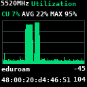
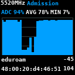
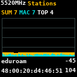
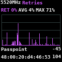
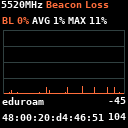
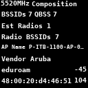

# Utilization

Utilization is a live 802.11 beacon and channel analyzer for WLAN Pi
hardware. It uses one fixed capture definition for the run: 20 MHz by default
on 2.4 GHz and 80 MHz by default on 5 GHz and 6 GHz. Advertised HT/VHT/HE/EHT
operation information scopes retry metrics to BSSIDs using the selected primary
channel. The application shows a rolling two-minute view of AP-advertised
channel utilization, admission capacity, station counts, channel composition,
and retry percentage.

The app automatically chooses the BSSID used for each display. You select only
the band and channel, not an SSID or BSSID.








## Requirements

The primary target is a WLAN Pi R4 running WLAN Pi OS 26.10 DeadEye
(Debian 13 Trixie) with:

- WLAN Pi FPMS 1.4.24 and its supported 128×128 display/control stick;
- Python 3.13 or newer (the Trixie target is Python 3.13);
- a monitor-mode-capable Wi-Fi interface supporting the selected frequency;
- `git`, `ip`, `iw`, Dumpcap and TShark 4.4 (verified with 4.4.19); and
- root access through `sudo`.

The adapter, driver, and regulatory domain must permit the selected channel
definition, not only its primary frequency. The application checks `iw phy`,
reads the actual configured definition back from `iw`, and reports a clear
error or a one-time 20 MHz fallback when the default 80 MHz definition cannot
be used.
Some adapters do not expose usable local survey counters, but beacon-based
screens can still work.

On Debian-based systems, missing command-line packages can be installed with:

```bash
sudo apt update
sudo apt install python3 python3-venv git iproute2 iw tshark wireshark-common
```

See [Troubleshooting](docs/troubleshooting.md) for hardware and setup checks.

## Install on WLAN Pi

```bash
git clone https://github.com/Yanzzee/WLANPi-Utilization.git
cd WLANPi-Utilization
sudo ./scripts/install_wlanpi_fpms.sh
```

The installer creates an isolated app environment under
`/opt/wlanpi-beacon-live`, adds `Utilization` to the FPMS Apps menu, creates the
runtime and log directories, installs the system-wide `wlanpi-utilization` and
`utilization` commands, and restarts `wlanpi-fpms`. New installs use the managed
runtime and install/start its idle broker. Saved explicit runtime settings are
preserved. It also installs web dependencies and the protected WLAN Pi Apps
entry and `/utilization/` route by default. The commands are launchers
in `/usr/local/bin` that run the existing executables in the isolated app
environment; the installer does not copy the application into the system
Python environment.

It also installs the pinned Core WebSocket client (`websockets 15.0.1`) into
the app environment. This downloads a runtime wheel on first installation;
for an offline Pi, pass `--wheel-dir DIRECTORY` containing a compatible wheel.

**Direct capture is the recommended default** for the standalone CLI and FPMS
application. Core is an optional backend for remote integration and future
compatible stream sharing; passing Core tests does not schedule a default
change. The current Core backend is owner-only and still uses local radio safety
and restoration. See [the backend decision](docs/core-capture-evaluation.md).
To opt FPMS into Core capture:

```bash
sudo ./scripts/install_wlanpi_fpms.sh --fpms-backend core
```

This saves `capture_backend` in `/etc/wlanpi-beacon-live/fpms.json`. Reinstalling
without that option preserves the choice. Use `--fpms-backend direct` to switch
FPMS back. A service environment override, `WLANPI_UTILIZATION_CAPTURE_BACKEND`,
takes precedence over the file. Invalid settings fail instead of selecting
direct capture. The standard CLI does not read this FPMS setting; select Core
explicitly with `--capture-backend core`:

```bash
sudo wlanpi-utilization --capture-backend core --iface wlanpi0 \
  --band 2.4 --channel 1 --channel-width 20
```

Core starts log `Capture backend: core` to stderr/the FPMS journal. The owner
backend still requires an existing `wlanpiN` monitor and supports verified
20/80 MHz configurations; see [Core acceptance](docs/core-capture-evaluation.md).

Rerun the same command after updating this repository or upgrading FPMS/WebUI. It
safely refreshes its managed CLI launchers as well as the application and FPMS
integration, and restores the protected web integration. Platform validation
runs before files are installed or capture is restarted. Installation restarts
the broker/FPMS and ends an active capture. Use `--without-web` only when skipping
web installation intentionally; `--with-web` remains a compatibility option.
It locates FPMS through its launcher's Python environment and
prints the resolved package path before patching.

The front panel and live CLI discover interfaces in the root and named network
namespaces. They prefer an existing monitor interface supporting the selected
frequency, such as WLAN Pi Core's `wlanpi0`. Multiple equally suitable candidates
require an explicit choice. Configure `WLANPI_UTILIZATION_IFACE` and, when needed,
`WLANPI_UTILIZATION_NETNS` in the FPMS service environment as described in
[Troubleshooting](docs/troubleshooting.md#the-wi-fi-interface-is-missing).

Live capture temporarily uses the entire selected physical radio. It refuses
an existing capture, active connection, or controller on that radio, and restores
saved interface modes, up/down states, and known monitor tuning when closed.
Existing WLAN Pi monitor interfaces are preserved. With one shared radio, stop
the other tool's radio use before starting Utilization and keep it stopped until
Utilization exits. See [radio ownership and restoration](docs/troubleshooting.md#the-radio-is-busy).

After installation, check TShark decoding without opening a radio:

```bash
/opt/wlanpi-beacon-live/bin/python scripts/check_tshark.py
```

For installation or capture failures, collect a diagnostic bundle from this
checkout with `sudo ./scripts/pi_collect_debug.sh`. See the
[Trixie release checks](docs/trixie-release.md) for tested behavior, remaining
hardware validation, and known follow-ups.

SSID bytes from TShark are decoded once before analysis. Printable UTF-8 names
appear as text in the displays and logs; empty or hidden names use the existing
hidden label. Non-text or control bytes retain a lossless `hex:…` representation.
For replay TSVs that already contain decoded names, use `--ssid-encoding text`
to preserve names that themselves look like hex. Raw TShark TSV replay defaults
to `--ssid-encoding hex`.

## Use the FPMS front panel

Open:

```text
Apps
  Utilization
    <band>
      <channel and center frequency>
        Start Session | Start + Log | Start Logging
```

- `Start Session` starts capture and opens the graphical screens.
- `Start + Log` starts the same display with CSV and JSONL logging enabled.
- `Start Logging` captures and logs in the background without opening a graph.
- `Stop Logging` disables logging while the managed capture session continues.

Logging start/stop messages briefly show the tuned channel, frequency, and log
folder. If shared logging is already active, the start action reports
**Logging already being saved** and preserves the existing files.

While a display is open:

- move up or down to cycle through the six screens;
- press left to detach the display and return to the session menu;
- the first auxiliary button is disabled;
- the second auxiliary button rotates the display 180 degrees while capture
  continues; and
- the third auxiliary button saves the current screen as a timestamped PNG in
  `/var/log/wlanpi-beacon-live`, then briefly confirms the folder without
  changing the active screen.

Changing screens never restarts capture or clears graph history.
In managed FPMS mode, opening Utilization checks the current session. When
idle, the menu offers band/channel selection. When active, it starts with
**Connect Session**, followed by **Stop Session** and either **Start Logging**
or **Stop Logging**, according to the shared owner's state.
Connect Session loads the existing display without changing its source or history.
The current band/channel appears briefly when connecting, with no
repeated popups during display refresh. Left detaches that managed display;
**Stop Session** explicitly ends capture. The visible menu updates after web/CLI
session or logging changes, normally within a few seconds. During cleanup it
shows Stopping Session, then returns to band/channel choices. Status checks run
in the background only while Utilization's menu is visible. Explicit legacy
standalone FPMS mode stops its foreground capture when leaving the display.

## Use the command line

The app name is **Utilization** in FPMS, terminal views, and the web
application at `/utilization/`. The preferred commands are
`wlanpi-utilization` and `utilization`. `wlanpi-beacon-live` and `beacon-live`
remain compatibility aliases. The Python package and existing `/opt`, `/etc`,
and log directories retain their original names so upgrades preserve saved
configuration and files.

### Shared managed session

Managed mode is opt-in while the new service completes device acceptance.
Install the service and select managed FPMS attachment together:

```bash
sudo ./scripts/install_wlanpi_fpms.sh --fpms-runtime managed
sudo wlanpi-utilization --managed --band 5 --channel 36 \
  --start-only --log-dir /var/log/wlanpi-beacon-live
sudo wlanpi-utilization --attach
sudo wlanpi-utilization session status --summary
```

The service starts idle; an explicit managed request starts capture. CLI and
managed FPMS opens join an active session, reporting **Session already running**
and retaining its actual tuning even if another channel was requested. Changing
source requires an explicit stop and new session. Closing a managed display or
leaving FPMS detaches the renderer and retains capture, logging, and history.
To stop the current managed session directly:

```bash
sudo wlanpi-utilization session stop --summary
```

The CLI reads the current session once and submits its actual ID. A replacement
session cannot be stopped by that request; a stale-ID error is not retried.
Stopping is asynchronous; use `session status --summary` to confirm cleanup.
Foreground standalone capture still stops with Ctrl+C.

Explicit controls use the actual `session_id` from status. The commands below read
it automatically; rerun the assignment after starting a new session. The word
`SESSION_ID` alone is not a valid session ID.

```bash
UTILIZATION_SESSION_ID="$(sudo wlanpi-utilization session status --summary \
  | python3 -c 'import json, sys; print(json.load(sys.stdin)["session_id"] or "")')"
sudo wlanpi-utilization session logging --session-id "$UTILIZATION_SESSION_ID" --enabled yes --summary
sudo wlanpi-utilization session stop --session-id "$UTILIZATION_SESSION_ID" --summary
```

The plain live command automatically attaches to an active managed session;
otherwise it starts foreground capture. `--standalone` explicitly selects
foreground mode. To restore standalone FPMS behavior, reinstall with
`--fpms-runtime standalone`. See [managed service operation](docs/managed-service.md)
for permissions, shutdown, failure behavior, and device checks.

### Web interface

The standard install/update command includes protected web hosting:

```bash
sudo ./scripts/install_wlanpi_fpms.sh
```

Open `https://<your-pi>/utilization/` or choose **Apps → Utilization** after
signing in normally. No SSH tunnel or separate integration command is needed.

For manual local development instead, start `sudo wlanpi-utilization web`, open
an SSH tunnel from your laptop and visit `http://127.0.0.1:8765/utilization/`:

```bash
ssh -N -L 8765:127.0.0.1:8765 wlanpi@wlanpi-bd2
```

The responsive page provides metrics, shared history graphs, sortable BSSID and Hosts tables,
session/logging/export controls, and closed CSV/JSONL/pcapng downloads. One session button
switches between Start session and Stop session. The start dialog has a logging
checkbox; Start logging/Stop logging remains a separate button during a session.
Beacon pcapng export has its own start-dialog checkbox and synchronized live
controls beside logging at the top and under Log files. Managed FPMS also offers
dynamic Start Export/Stop Export actions.
Export retains original beacon bytes/times/radiotap from the shared source,
rotates every hour or 256 MiB, and saves files without a default count/total-size
cap. It stops export at a 256 MiB free-space reserve and closes buffered output. See [export controls and policy](docs/beacon-export.md).
Opening, refreshing, or closing the page leaves capture running. The manual
development server listens on loopback.

Hosts shows observed wireless client MACs, vendor/local indicator, latest observed
SSID/BSSID context, last activity, last transmitted RSSI, Tx/Rx data-frame counts
and Tx retry percentage from the same rolling two-minute window. Missing signal
or retry data stays unavailable. See [host observation rules](docs/web-interface.md#hosts-tab).
See [protected deployment and Pi acceptance](docs/web-deployment.md)
for supported platform checks, rollback and login/logout acceptance, and
[web operation](docs/web-interface.md) for controls and metric behavior.

### Standalone commands

The normal FPMS installation makes both CLI commands available system-wide:

- `wlanpi-utilization` runs live capture directly; and
- `utilization` provides the `live`, `replay`, and `retry-debug` workflows.

Live capture configures the wireless interface, tunes it, and starts TShark,
so it normally requires `sudo`. Replay and help do not require root. Writing
to `/var/log/wlanpi-beacon-live` also requires appropriate permissions, which
the examples below obtain with `sudo`.

```bash
# Live terminal display on channel 36
sudo wlanpi-utilization --band 5 --channel 36

# Logging-only capture (both CSV and JSONL, with no display rendering)
sudo wlanpi-utilization --band 5 --channel 36 \
  --logging-only --log-dir /var/log/wlanpi-beacon-live

# Interactive display plus both log formats
sudo wlanpi-utilization --band 5 --channel 36 \
  --log --log-dir /var/log/wlanpi-beacon-live

# Hardware-free replay of the included sample (run from the repository)
utilization replay --input samples/tshark_qbss_sample.tsv

# Explicit 6 GHz center frequency instead of band/channel mapping
sudo wlanpi-utilization --frequency-mhz 5975

# Explicit 160 MHz override: primary 5180 MHz, center 5250 MHz
sudo wlanpi-utilization --frequency-mhz 5180 \
  --channel-width 160 --center-frequency1-mhz 5250

# Save full packets from the exact live-analysis process and a JSON sidecar
sudo wlanpi-utilization --band 5 --channel 36 \
  --raw-pcapng /tmp/utilization-channel36.pcapng

# Explicit interface in an existing named network namespace
sudo wlanpi-utilization --iface capture1 --netns capture-lab --band 2.4 --channel 1

# General and workflow-specific help
wlanpi-utilization --help
utilization --help
utilization live --help
```

`utilization live` accepts the same live options as `wlanpi-utilization`. Use
`--frequency-mhz` when the exact primary/control frequency is clearest, or combine
`--band` and `--channel` when a channel number is ambiguous across bands.
`--channel-width auto` is the default: 20 MHz on 2.4 GHz and the standard
80 MHz block containing the selected primary on 5 GHz and 6 GHz. The capture
does not retune in response to beacon contents. Explicit widths above 20 MHz
require `--center-frequency1-mhz`; 80+80 also requires
`--center-frequency2-mhz`.

Retry numerator and denominator include only eligible frames associated through
BSSID/TA/RA/SA/DA with a BSSID whose fresh beacon advertises the selected
primary. Frames before that beacon is discovered, unknown associations, stale
definitions, and BSSIDs using a secondary portion as their own primary are
excluded. The result means all valid frames the configured radio, PHY, driver,
and TShark successfully decode—not literally every frame transmitted over RF.

Hardware capture capability can be narrower than the channel definition that
`iw` successfully configures. In WLAN Pi testing, an MT7921U could tune an
80 MHz 6 GHz channel but delivered only Null/QoS Null data frames while another
capture device received payload-bearing QoS Data. Treat this as a possible
adapter/driver/firmware limitation, not an application filter; validate retry
coverage with `--raw-pcapng` before relying on that combination.

### Interactive SSH dashboard

When both standard input and output are attached to a terminal, live CLI mode
opens one full-screen `curses` dashboard similar to `top`. It renders directly
from the shared live `MetricsSnapshot`; it does not read CSV or JSONL logs.
The screen contains all five 120-second metric groups, strongest-radio channel
composition, independently selected BSSIDs, and a vertically and horizontally
scrollable per-second table.

An abridged wide-terminal example looks like this:

```text
 5180 MHz | Band 5 GHz | Channel 36 | Utilization | 120s history | FOLLOW
BSSIDs 8 QBSS 6 Radios 3 Radio BSSIDs 4 Radio Stations 28       Selected BSSIDs
Strongest AP: AP-Lobby  Vendor: Example Vendor  Metric   Value BSSID ...
  # BSSID                RSSI STA SSID             STA max     17 aa:aa:... -45dBm Alpha
* 1 aa:aa:aa:aa:aa:aa  -45dBm  17 Alpha            RET max     4% aa:aa:... -45dBm Alpha
  2 aa:aa:aa:aa:aa:ab  -47dBm  11 Guest
                                                Logging to logs/beacon_live_..._stats.csv
                                                Logging to logs/beacon_live_..._beacons.jsonl
QBSS ADC  ▇▇▆▆▅▅▄▄▃▃...              ADC   48%  AVG   55%  MIN   31%
QBSS CU   ▁▂▂▃▄▃▅▆▅▇...              CU    62%  AVG   44%  MAX   81%
QBSS STA  ▂▂▃▃▃▄▄▄▄▅...              SUM    28  MAC     9  TOP    17
FRAME MAC ▁▁▁▂▂▁▃▂▂▃...              SUM    28  MAC     9  TOP    17
FRAME RET ▁▁▂▁▁▃▂▁▁▂...              RET     4%  AVG    3%  MAX   11%
BCN LOSS  ▁▁▁▁▂▁▁▃▁▁...              BL      1%  AVG    2%  MAX    8%
TIME     BSSIDS QBSS_BSSID       SSID                 RSSI  PEAK  ADC%   CU% ...
14:30:05 8      aa:aa:aa:aa:aa:aa Alpha                -45   -40   48.0   62.0 ...
```

All BSSID/SSID pairs assigned to the strongest estimated radio are shown at
once. The `*` row is the selected QBSS source; its BSSID and SSID are bold in
the live terminal. `STA` is each BSSID's latest advertised QBSS station count.
`Radio Stations` sums those values for the strongest estimated radio; it is not
a deduplicated client count. The right column identifies the BSSIDs
independently selected for the highest station count and retry value.
The station selection compares each BSSID's latest advertised QBSS count with
its rolling observed client-MAC count; QBSS wins an equal-count tie.

Controls:

- Up/Down scroll the table one row; Page Up/Down scroll one visible page.
- Home jumps to the oldest retained row; End resumes following the newest row.
- Left/Right scroll the wide `SecondStats` table horizontally.
- Space pauses or resumes dashboard updates. Capture, analysis, and logging
  continue while paused; resuming jumps directly to the current snapshot.
- `q` or Ctrl-C exits capture cleanly.
- Terminal resizing is detected automatically and immediately recalculates the
  layout.

The table follows each new second until you scroll upward or press Home. The
graphs always represent the entire retained history: on narrow terminals,
adjacent samples are compressed into the available columns instead of dropping
the latest data. Once all 120 history columns fit, each graph's summary follows
the graph directly instead of being pushed to the terminal's right edge. A
terminal around 120×30 or larger is recommended for the
side-by-side identity columns. Below 116 columns they stack vertically. A
24×15 terminal can show one strongest-radio BSSID with compact graphs and a
table row; each additional BSSID requires another row. Smaller windows show a
resize prompt.

Multiword table headers use underscores. Raw QBSS CU, Retry-bit-readable frame
count, retry-frame count, received-beacon count, and selected beacon rate remain
in the analyzer state but are omitted from the scrolling display table. The CSV
is unchanged: it retains all of those fields and also records the top station
count, whether its source was `qbss` or `mac`, and its SSID/BSSID.

`TOP_STA` and `TOP_SRC` also remain available in analyzer snapshots and CSV
logs but are intentionally omitted from the scrolling display table.

Scrolling table columns:

| Column | Meaning |
| --- | --- |
| `TIME` | Local wall-clock time for the one-second sample. |
| `BSSIDS` | BSSIDs whose beacons are retained in the rolling window. |
| `QBSS_BSSID` | BSSID supplying `CU%`, `SEL_STA`, and `ADC%`. |
| `SSID` | SSID of the automatically selected QBSS BSSID. |
| `RSSI` | RSSI from that BSSID's latest retained beacon, in dBm. |
| `PEAK` | Strongest RSSI retained for that BSSID in the rolling window, in dBm. |
| `ADC%` | Selected BSSID's latest QBSS admission capacity as a percentage of 31,250. |
| `CU%` | Latest channel-utilization percentage from the automatically selected QBSS BSSID. |
| `LOCAL%` | Optional local survey utilization from `iw`; when enabled, it follows `CU%`. |
| `STA_SUM` | Sum of the latest QBSS station count advertised by every retained BSSID; missing counts contribute zero. |
| `SEL_STA` | Latest QBSS station count advertised by the selected QBSS BSSID. |
| `MAC` | Unique eligible wireless client MACs observed during this second; this is not an associated-station count. |
| `FRAMES` | All decoded 802.11 frames delivered to the analyzer during the second. |
| `RET_ELIG` | Primary-scoped unicast data and retry-capable unicast management frames eligible for the retry denominator. |
| `RETRY%` | Eligible frames with the Retry bit set divided by `RET_ELIG`. |
| `TOP_RETRY_BSSID` | BSSID selected for the one-second retry result: highest retry percentage, retained selection on a tie, or strongest beacon RSSI when no retries occurred. |
| `BCN_EXP` | Phase-matched beacon transmission slots expected during the second across recently heard BSSIDs above -75 dBm. |
| `LOSS%` | Percentage of `BCN_EXP` slots for which no matching beacon was received. |

If the command is piped, redirected, run without a TTY, or Python lacks
`curses`, Utilization uses the existing plain renderer. This also keeps
automated invocations usable. Logging remains independent in either display
mode: `--log` enables both formats alongside the interactive TUI,
and the TUI shows each active output path below `Selected BSSIDs`.
`--stats-csv` and `--beacons-jsonl` remain available when only one format is
wanted, while `--logging-only` writes both formats without starting any
terminal dashboard.

For troubleshooting, the system launchers and their isolated targets are:

```text
/usr/local/bin/wlanpi-utilization -> /opt/wlanpi-beacon-live/bin/wlanpi-utilization
/usr/local/bin/utilization        -> /opt/wlanpi-beacon-live/bin/utilization
/opt/wlanpi-beacon-live/bin/python
/opt/wlanpi-beacon-live/lib/python*/site-packages/beacon_live
```

The arrows describe which executable each launcher invokes; the launchers are
small managed shell scripts, not filesystem symlinks. You can bypass the PATH
launcher while diagnosing an installation with, for example,
`/opt/wlanpi-beacon-live/bin/utilization --help`.

## Screens

| Screen | What it shows |
| --- | --- |
| Utilization | Channel utilization advertised by the automatically selected QBSS BSSID. |
| Admission | The selected BSSID's advertised admission capacity as a percentage. |
| Stations | AP-advertised QBSS station counts plus unique client MACs observed in BSSID-linked data frames. |
| Retries | The one-second retry percentage for eligible frames heard on the channel and the BSSID with the most retries. |
| Beacon Loss | Percentage of phase-aware expected beacons not received across all recently heard BSSIDs above -75 dBm. |
| Composition | BSSID and QBSS counts plus best-effort physical-radio, `AP` (vendor AP-name), and vendor information. |

Graphs retain the latest 120 seconds. Missing or unavailable measurements are
shown as gaps or `--`. On Stations, the amber series is the AP-advertised QBSS
sum and the cyan overlay is the unique client-MAC count detected in each
second. `MAC` is the deduplicated client total for the full rolling window;
it remains separate from the advertised station count. AP QBSS utilization is
also separate from optional local survey utilization.

See the [screen reference](docs/screens.md) for metric definitions, selection
rules, and display details.

## Logging

Front-panel logs are written under `/var/log/wlanpi-beacon-live`. A logging
session can write per-second statistics as CSV and valid beacon records as
JSONL.

Logging checks free space every 30 seconds, stops below 256 MiB free, and adds
an end-of-log marker explaining the disk-pressure stop. Long-running sessions
roll to a new file pair every hour. If low disk stops logging while the display
is active, capture, analysis, and graph history continue. Logging-only mode
exits cleanly.

See the [logging reference](docs/logging.md) for formats, filenames, rollover,
markers, and configurable CLI limits.

## Development environment

The repository `.venv` workflow is only for development and testing; it is
separate from the supported `/opt/wlanpi-beacon-live` installation used by
FPMS and the system-wide commands.

```bash
python3 -m venv .venv
source .venv/bin/activate
python -m pip install --upgrade 'pip>=24.3' 'setuptools>=75.3' wheel
python -m pip install -e '.[dev]'
.venv/bin/utilization replay --input samples/tshark_qbss_sample.tsv
.venv/bin/python -m pytest -q
```

On the Pi, run `./scripts/pi_setup.sh` after activating this environment. It
requires a genuine venv without system site-packages, validates Python 3.13+,
and runs CLI/replay checks and pytest. Run development setup without `sudo`.
An older development environment should be replaced with a fresh Python 3.13
venv. The production installer verifies the same Python/venv requirements
before copying the application into `/opt/wlanpi-beacon-live`.

## Documentation

- [Managed runtime roadmap](docs/managed-runtime-roadmap.md) — v2.1.0 plan for
  shared web/CLI/FPMS sessions and beacon pcapng export; current development
  metadata is 2.1.0.dev0.
- [Web interface](docs/web-interface.md) — installation, shared-session controls,
  closed log downloads, and browser acceptance checks.
- [Beacon pcapng export](docs/beacon-export.md) — live/offline controls, packet
  fidelity, rotation/retention limits, storage isolation and device acceptance.
- [Busy-channel validation](docs/busy-channel-validation.md) — corrupt-frame
  identity guards, capture-quality evidence, and Pi performance/retest steps.
- [Trixie roadmap](docs/trixie-roadmap.md) — ordered compatibility milestones
  and acceptance checks for WLAN Pi OS 26.10 DeadEye.
- [Architecture](docs/architecture.md) — design rules, pipeline, data flow, and
  Phase 1–5 history.
- [Screen reference](docs/screens.md) — screen metrics, navigation, BSSID
  selection, retry rules, and radio grouping.
- [Logging reference](docs/logging.md) — logging modes, formats, disk safety,
  and rollover.
- [Troubleshooting](docs/troubleshooting.md) — installation, capture, display,
  and metric issues.
- [Development](docs/development.md) — repository layout, setup, tests, replay,
  and contribution guidance.
- [Pi testing](docs/pi_testing.md) — detailed hardware smoke tests, retry
  audits, and on-device acceptance checks.
