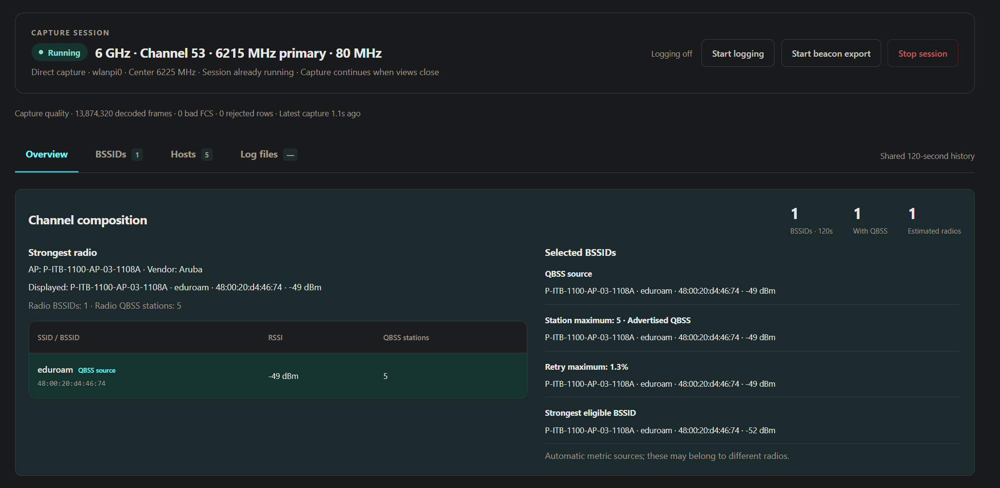
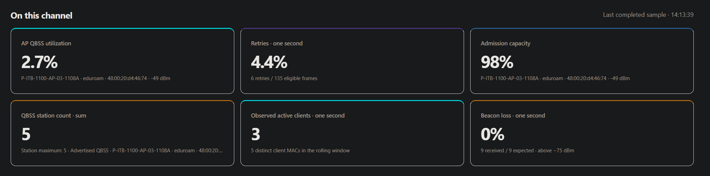
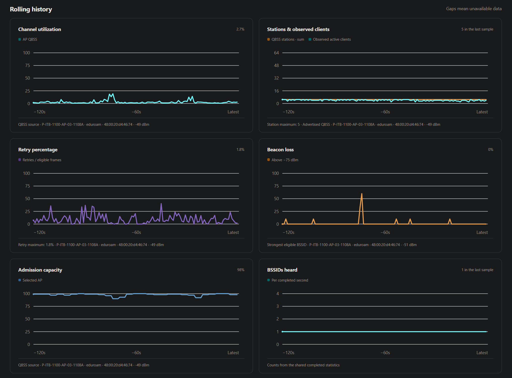

# Utilization web interface

The v2.1.0 web interface uses the managed session at
`/utilization/`. It provides current metrics, six shared-history graphs,
sortable BSSID and Hosts tables, explicit session/logging controls, and closed
CSV/JSONL and beacon pcapng downloads. Direct capture remains the default; Core is optional.

## Install and open on a Pi

Install/update the application, FPMS, broker and protected web hosting together:

```bash
sudo ./scripts/install_wlanpi_fpms.sh
```

Open `https://<your-pi>/utilization/` or Apps → Utilization through the normal
WLAN Pi login. The installer includes web dependencies and integration by default;
no separate integration command or SSH forwarding is required. Saved FPMS/backend
settings are preserved. See [protected deployment](web-deployment.md).
The manual loopback/SSH procedure below remains available for local development.

For a manual loopback server after installation:

```bash
sudo wlanpi-utilization web
```

Reinstallation updates/restarts the managed service. Stop an existing capture
first if you need to preserve its normal shutdown evidence. Both the broker
and web process need the updated code for the closed-file inventory.
The installer copies local HTML/CSS/JavaScript assets and installs Flask and
Waitress in the application's isolated venv. `--wheel-dir DIRECTORY` also
supports offline installation when that directory contains all required Core
and web dependency wheels. New FPMS installations use managed attachment;
CLI capture attaches to an active managed session and otherwise starts foreground
capture unless requested with `--managed`.

The web server stays in the foreground and binds `127.0.0.1:8765`. From a
laptop, leave this SSH tunnel running:

```bash
ssh -N -L 8765:127.0.0.1:8765 wlanpi@wlanpi-bd2
```

Open `http://127.0.0.1:8765/utilization/` on that laptop. Replace the hostname
with your Pi. A browser running on the Pi can open the same URL directly.
`--port`, `--socket`, `--log-dir`, and `--url-prefix /example/` are available;
use the same log root as the managed capture if you need downloads.

The privileged Unix broker socket remains private. The current `sudo` web
command accesses it as root; no socket permissions are widened. The HTTP CLI
accepts only IPv4 loopback or localhost. It uses Waitress without a development
reloader, local assets, host/origin checks, a per-process CSRF token for controls,
and no response caching. Restarting this web process invalidates tokens;
reload open pages before sending another control.

The milestone 4 adapter adds a protected Apps entry, HTTPS route and
separate web service through a private Unix socket. It protects page, status,
controls and downloads with the platform login. It is included in the standard
installation; the manual command above retains loopback operation.

## Use the shared session

Opening a page reads the service; an idle service stays idle. Choose **Start
session** explicitly, or start through managed CLI/FPMS and open the page later.
The page embeds the current publication at load and immediately displays an
existing session's ID, phase and retained history before the first poll returns.
Band/channel/width apply only to a new session. Advanced source fields offer
the existing automatic interface/namespace discovery and optional Core backend.
The session header shows the owner's resolved interface/namespace once discovery
publishes it, while the requested configuration retains `iface=auto` if selected.
There is no SSID/BSSID selector.

The single session button shows **Start session** while idle and **Stop session**
in the active/danger color while starting or running. It shows **Stopping…** and
is disabled during shutdown. Start opens the channel setup dialog, including
the existing CSV/beacon JSONL logging checkbox. During a session the separate
**Start logging / Stop logging** button controls logging. It is disabled while
idle, stopping, disconnected or when the owner has no configured log formats.

The start dialog also offers **Start beacon pcapng export**. Its independent
**Start beacon export / Stop beacon export** controls appear beside logging at
the top and under Log files. Both follow the same shared export state. Log files
shows current-file/closed counts, skipped records, errors and the configured
rotation/retention policy. Web and managed CLI/FPMS starts configure the shared
full-packet source for later export toggling. Existing legacy/raw-diagnostic
sessions require a new export-capable session. See [beacon export operation](beacon-export.md).

Primary channel is a band-specific dropdown: 2.4 GHz channels 1–14, the normal
5 GHz 20 MHz primary grid, and 6 GHz channels 1, 5, …, 233. Bonded-channel
center numbers are not offered as primaries. The server validates the same
grid, including hand-edited requests. Adapter/regulatory availability and width
support still determine whether capture can start.
6 GHz preferred scanning channels use labels such as **5 (PSC)**; the submitted
channel remains the integer. Session tuning shows the primary frequency,
width in MHz and center frequency/frequencies supplied by the owner. Requested
or unverified tuning is labeled accordingly.

Session setup follows **Band → Capture width → Primary channel**. The width
menu labels **Band default (20 MHz)** on 2.4 GHz and **Band default (80 MHz)** on
5/6 GHz. 2.4 GHz offers 20/40 MHz, 5 GHz offers 20/40/80/160/80+80, and 6 GHz
also offers 320 MHz. The channel dropdown includes only primaries belonging to
a valid block for the selected width. Band default also filters to its displayed
width; select **20 MHz** explicitly to access upper 6 GHz edge channels without
an 80 MHz block. The runtime/CLI edge fallback remains unchanged. A primary is
preserved when changing width if it remains valid; otherwise a valid choice
replaces it. 6 GHz PSC labels remain on available primary channels.

At 20 MHz, the center equals the primary frequency. At 2.4 GHz 40 MHz, the
center is 10 MHz above or below the primary. The channel dropdown combines each
valid primary/secondary pairing with its bonded center: **6 + 10 · center
2447 MHz (Ch 8)** and **6 + 2 · center 2427 MHz (Ch 4)**. The primary remains
channel 6 in both requests; center channel 8 or 4 never replaces it. Channel 14
is omitted at 40 MHz. No separate center selector appears for these pairings.

Other unique centers are derived automatically and their selectors stay hidden.
An explicit selector appears only when there is more than one valid choice,
labelled, for example, **6265 MHz (Ch 63)**. This retains overlapping 6 GHz
320 MHz placements and the second nonadjacent segment for 80+80 MHz. The first
80+80 segment contains the primary. No free-text center is accepted. The web
start endpoint validates the same fixed plan, including hand-edited requests.
The standard channel plan does not override adapter capabilities or regional
restrictions checked at start.

Fixed center channels used by the form:

| Band | Width | Center channels |
| --- | --- | --- |
| 2.4 GHz | 40 | 3–11, step 1 |
| 5 GHz | 40 | 38, 46, 54, 62, 102, 110, 118, 126, 134, 142, 151, 159, 167, 175 |
| 5 GHz | 80 / each 80+80 segment | 42, 58, 106, 122, 138, 155, 171 |
| 5 GHz | 160 | 50, 114, 163 |
| 6 GHz | 40 | 3–227, step 8 |
| 6 GHz | 80 / each 80+80 segment | 7–215, step 16 |
| 6 GHz | 160 | 15–207, step 32 |
| 6 GHz | 320 | 31, 63, 95, 127, 159, 191 |

The plan is checked against [IWD 3.4 operating-class tables](https://kernel.googlesource.com/pub/scm/network/wireless/iwd/+/refs/tags/3.4/src/band.c)
and [Linux v6.12 channel-definition rules](https://github.com/torvalds/linux/blob/v6.12/net/wireless/chan.c).
The normal 20 MHz primary grid and existing runtime defaults remain unchanged.

Capture source now has an interface dropdown with **Automatic discovery** plus
all wireless interfaces reported by `iw dev` in root and named network namespaces,
including each mode and namespace. It loads when setup opens; **Refresh
interfaces** repeats the read (inventory is cached for five seconds). Discovery
uses only `iw dev` and `ip netns list`/read-only namespace execution, with a
five-second overall budget and partial-error reporting. It never captures,
retunes or changes an interface mode. Selecting a concrete interface also fills
its namespace; automatic mode retains an optional namespace restriction. A
selected interface that disappears stays marked Unavailable and blocks submission
until another valid choice is made, rather than silently switching radios.

Overview places channel composition above **On this channel**. The strongest
estimated radio lists AP name/vendor, its currently displayed SSID/BSSID/RSSI,
all grouped BSSIDs and their advertised station counts, and a QBSS-source mark.
The adjacent selected-BSSID section identifies the QBSS source, station maximum,
retry maximum and strongest beacon-loss-eligible BSSID independently. It follows
the [TUI identity rules](screens.md#web-organization): these sources need not
belong to one radio. Station maximum uses the analyzer's QBSS/observed source
and count, rather than borrowing the QBSS reporting identity.



Six current cards show AP QBSS utilization, retries, admission capacity,
advertised station sum, observed active clients and beacon loss. The duplicated
one-second BSSID card is removed; rolling composition counts and the completed
second BSSID graph retain their distinct scopes. Local survey reporting and
its web start option are hidden pending adapter validation. The existing engine,
CLI option, API fields and logs retain their definitions; a future verified
survey display can add a separate line to the CU graph.



Desktop displays all six graphs. Small screens
keep the same metric cards and offer a graph selector. The BSSID table uses
latest snapshot beacon values and explicitly labels rolling observations.
AP name and the existing metric columns are sortable; missing AP names sort
last in either direction. Sorting changes table presentation only. Protected
hosting reuses WLAN Pi's existing browser-tab and touch icons.



Null fields display an em dash; real zeros remain zero. Unavailable graph
samples break the line. Nonzero retries below 1% display as `<1%`. Capture width,
collecting state, partial-coverage notices, errors, and logging/disk warnings
come from the owner publication. The browser does not close analyzer buckets
or advance capture history using its clock. A stopped session retains its final
values until an explicit new session.

All HTTP threads share a one-second read cache. Tabs, graph selection, sorting,
reloads, disconnects, and extra browsers never start capture or reset history.
A failed read keeps the last values visible, marks the connection disconnected,
disables controls, and retries with bounded backoff. The displayed receive time
uses the browser's local timezone with a 24-hour HH:MM:SS clock and means a
successful service response; the completed sample time identifies the
data. Delayed/stalled capture can therefore retain an older sample time.

Capture quality shows the owner's decoded-frame, bad-FCS and rejected-row
counts and stream age from server time. Known corrupt frames cannot create
clients/BSSIDs or retry samples. A late stream does not by itself establish a
performance bottleneck; see [busy-channel validation](busy-channel-validation.md)
for interpretation, exact synthetic regressions, and a repeatable Pi test.

**Stop logging** closes CSV/JSONL while analysis continues. **Stop session**
requests the owner's normal cleanup and radio restoration. Controls carry the
current session ID; a stale page cannot stop a replacement session. A new start
can briefly be rejected while the previous owner process finishes cleanup;
wait for shutdown to finish and retry. Controls are never retried automatically.
Sessions created without configured logging formats have logging disabled in
the page; web-created sessions configure both formats for later toggling.

## Hosts tab

**Hosts**, next to BSSIDs, lists observed wireless clients from the shared
120-second window. Each column is sortable; rows initially sort by most recent
activity. Tables scroll horizontally on small screens. Opening the tab renders
the latest publication immediately; the page does not maintain another analyzer
or capture. Hidden host rows are not rebuilt on every poll.

| Column | Meaning |
| --- | --- |
| MAC | Unicast wireless data-frame transmitter/receiver, excluding known AP BSSIDs. |
| Vendor / local indicator | TShark's local manufacturer lookup when available; **Locally administered** when the MAC's local bit is set, otherwise **Unknown** if unresolved. |
| SSID / BSSID | Latest observed BSSID context and that BSSID's newest retained beacon SSID. This does not confirm association. |
| Last activity | Last captured data frame to or from this client, shown in local 24-hour time; full date is available on hover. |
| Last transmitted RSSI | Signal measured at the WLAN Pi on this client's latest captured transmission. A downlink from its AP never supplies client RSSI. |
| Tx / Rx frames | Captured data frames transmitted/received by the client within the rolling window, including each retry transmission. |
| Tx retry % | Retry-bit transmissions divided by this client's retry-eligible transmitted data frames in the window. Missing Retry bits are excluded from this denominator. |

Host eligibility reuses the existing observed-client rules: valid unicast TA/RA
data endpoints involving a known BSSID on the selected primary scope. Distribution
system SA/DA addresses, probe traffic, group addresses and known corrupt frames
do not create host rows. This intentionally does not enumerate every source
address heard on the channel. Host counters are capture observations and cannot
establish actual traffic volume, throughput or association counts. Channel retry
metrics retain their existing denominator, which also includes eligible management
frames and downlinks; it differs from the host Tx denominator.

RSSI is unavailable for receive-only clients or when the latest transmitted frame
lacks signal metadata. No eligible transmitted Retry bit means unavailable retry
percentage; an observed zero stays zero, and nonzero retries below 1% show `<1%`.
Counters and identities expire with the shared rolling window. Stopped sessions
retain their final snapshot until a new session starts.

Manufacturer fields are requested only if the installed TShark supports them
(`wlan.ta.oui_resolved` / `wlan.ra.oui_resolved`). They use the existing MAC-only
name resolution; there are no per-host lookup processes or network requests.
A locally administered address does not reliably identify a manufacturer or
prove randomization. Hostnames, IP discovery, throughput estimates and additional
per-host graphs are excluded.

Detail summaries are bounded to 1,024 identities per second and 1,024 published
rows. Across buckets, the newest retained identities are preferred. A visible
notice identifies detail omission or possibly incomplete host counters on very
busy channels. The existing observed-client count is not capped; the tab badge
shows that full count, while the table summary also gives the number shown.
Per-second summaries are built in the existing frame pass, merged at completed
bucket publication, and discarded as the window expires; no host packet history
is added. See [TShark WLAN fields](https://www.wireshark.org/docs/dfref/w/wlan.html)
and [TShark resolution options](https://www.wireshark.org/docs/man-pages/tshark.html).

## Download contract

Only successfully closed CSV/JSONL and beacon pcapng segments registered by the
capture owner are offered. CSV/JSONL hourly rollover, explicit logging stop, capture stop, and normal
low-disk close register completed files. Active segments remain excluded;
stop logging to download them while capture/history continue.
Beacon pcapng defaults to hourly/256-MiB rotation with no file-count or total-size
cap; a 256 MiB free-space reserve stops export without deleting completed files.
Stop export drains accepted packets and closes its current file. Partial/failed output is never offered.

The logging owner records device/inode, size, and modification time from the
original open descriptor after flushing. A bounded broker catalog keeps the
latest 256 registered records across capture sessions for that broker lifetime.
Each publication carries at most 128 CSV/JSONL and 256 beacon export closed records. Restarting the
broker clears the catalog; the UI does not scan historical directories. The
files themselves remain on disk under the existing logging policy.

Downloads use opaque file IDs and only files under the configured log root.
The web process refuses symlinks, traversal, changed/replaced files, and active
paths. Removed or changed records show **Unavailable** and return 404. A
download whose descriptor is already open can finish if its name is later
removed by retention. File reads/HTTP backpressure stay in the web process,
independent of capture and ordered analysis. Optional, explicitly enabled export retention applies only to owned reserved-name
pcapng segments in its dedicated directory, including across sessions. Default
sessions do not delete completed files. See [export limits and storage failure](beacon-export.md#rotation-retention-and-storage-failure).

## Pi browser acceptance

Record revision, image/Python/browser versions, adapter, backend, band/width,
namespace, and diagnostic bundle. These checks complement the existing
[managed service acceptance](managed-service.md#web-boundary-and-device-acceptance).

1. Run the standard installer and open **Apps → Utilization** through normal
   WLAN Pi HTTPS login. No manual web command or SSH tunnel is required.
   An idle service must stay idle until an explicit start, including after reboot.
2. Start direct capture through the page. Attach CLI and FPMS on the same
   source. Record one owner/TShark/analyzer and matching session ID, metrics,
   history, width/coverage notices, and logging status.
3. Check a desktop browser and phone-sized viewport, keyboard navigation,
   scrolling, dialog validation, graph selection, table sorting, and long or
   hidden SSIDs. Inspect real missing QBSS/survey fields, true zero, `<1%`
   retries, and graph gaps when those conditions occur.
4. Open another tab/browser; reload, switch views, close every browser, and
   reconnect. Capture/logging must continue with the same ID and history.
   Compare CPU/RAM and publication lag with CLI/FPMS-only operation.
   In Hosts, verify local/vendor indicators, client-only transmitted RSSI,
   receive-only missing values, 24-hour activity, sorting and expiry. Compare
   MAC/BSSID directions and Tx retries against a short mixed-frame diagnostic
   capture, accounting for monitor-mode losses. Check busy download/upload with
   Hosts visible and hidden, then verify a new session clears previous rows.
5. Toggle logging off without stopping capture. Download CSV/JSONL, parse them,
   and compare completed values with the session. Verify new segments after
   toggling on/rollover, and explicit unavailable status for removed files.
6. Restart only `wlanpi-utilization-web`, then reconnect. Confirm the broker
   retains capture/history. Restart the web process and reload to renew its
   CSRF token. Test missing socket, service failure, and slow downloads without
   retuning or capture restart.
7. Stop through the page, verify normal owner cleanup and physical radio
   restoration, then start a new session and check the new ID. Verify stale-ID
   controls are rejected and earlier registered downloads remain available.

Automated tests cover the API, real broker with synthetic owner, original
snapshot/completed statistics, read-only consumers, closed-file identity and
download races, and optional-dependency installation. Actual responsive browser
rendering and these Pi hardware/performance checks remain acceptance gates.

## Launcher and direct hosting

Protected Apps hosting is installed by default in 2.1.0. Pi 4 Apps access,
login/logout/expiry and page availability after reboot/relogin were confirmed
during development. The review history below explains the integration; use
[protected deployment](web-deployment.md) for current install/repair steps and
[release checks](release-2.1.0.md) for the final release pass.

The user reports good Pi 5 display operation and an October 19 speedtest without
the earlier count spikes, with different conditions that prevent claiming exact
replication. The next device check is direct access through the WLAN Pi Apps
menu. Review of upstream WebUI
revision `2b112f5a739e4647de4f5fd48948cd16e4d07d94` found an existing
[internal Nginx auth subrequest](https://github.com/WLAN-Pi/wlanpi-webui/blob/2b112f5a739e4647de4f5fd48948cd16e4d07d94/install/etc/nginx/wlanpi_webui.conf),
[session check/revocation hook](https://github.com/WLAN-Pi/wlanpi-webui/blob/2b112f5a739e4647de4f5fd48948cd16e4d07d94/wlanpi_webui/auth/auth.py),
and [Apps-card template](https://github.com/WLAN-Pi/wlanpi-webui/blob/2b112f5a739e4647de4f5fd48948cd16e4d07d94/wlanpi_webui/templates/partials/apps_cards.html).
The installed Pi image must be checked against these hooks; source review
alone does not establish its authentication behavior.

Collect that evidence without importing WebUI or changing services:

```bash
sudo python3 scripts/pi_web_preflight.py
```

The normal diagnostic bundle also includes this report. It prints source/config
paths, hashes, and candidate-hook checks; it reads no session stores or keys.
`integration_candidate: true` identifies matching source markers, not verified
authentication or enabled hosting. Use `--webui-root` and `--nginx-config` for
nonstandard installed paths.

The implemented adapter adds a full-page Utilization launcher link and a
protected `/utilization/` proxy to a separate private Unix-socket backend.
It validates supported platform sources, preserves existing Apps cards, and
provides repeat installation, backups and rollback. API expiry displays the
normal sign-in link while capture continues. See
[installation and installed-image acceptance](web-deployment.md) for commands,
authentication boundaries and remaining Pi login/logout/expiry checks. The
read-only preflight itself still changes no services or Nginx rules. Custom
Core endpoints remain unnecessary for this integration.
